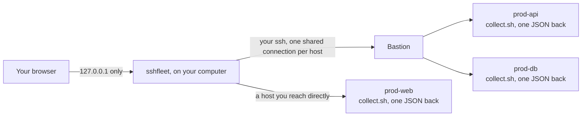

# How it works

Nothing is installed on the servers. Each check streams a short shell script through the
connection that is already open; it prints one JSON document and exits. The SSH config files you
already keep are the inventory, and OpenSSH does every authentication: sshfleet records where a
key is and never reads it.

## How it stays fast

* One `ssh_config` of its own that `Include`s yours and turns on `ControlMaster`. OpenSSH passes
  it down to the `ProxyJump` hop, so the bastion connection is shared too and later commands skip
  the handshake entirely.
* One round-trip per host per refresh: a single script that prints one JSON document. It needs no
  `jq` and no interpreter on the server.
* Bastions are opened first, then the main services, then everything else. A host whose bastion is
  down is marked without being contacted, so one dead bastion costs one timeout instead of one per
  host behind it.
* Connections open on a short deadline separate from the command deadline, so an unresponsive host
  cannot set the pace for the whole refresh.
* Log filtering runs on the server; `--tail` always accompanies `--since` because the Docker log
  reader scans from the start of the file without it.

## What a refresh costs the servers

One `ssh` round-trip per host, running a single shell script that reads `/proc`, `df`, the
container runtime's `ps` and `inspect`, the listening ports and one `curl` against the health
endpoint. Measured on a two-container host it is about 0.12 CPU-seconds per refresh; on a
17-container host about 0.4, roughly half of it inside `dockerd`. Two side effects are worth
knowing: every refresh runs a few `sudo` commands, which each add a line to the host's auth log,
and a health endpoint that logs every call will see one call per refresh — which is what
`hosts.<alias>.health.min_interval_s` is for.

## When the laptop sleeps

The shared connections die with the network, and OpenSSH notices within about 45 seconds
(`ServerAliveInterval` 15 × 3). Nothing is lost: the next check opens them again, the fleet
view fills back in as hosts answer, and a tunnel you had switched on is reopened by the web
server's watcher, quickly at first and then once a minute while the network stays away. A
tunnel you closed yourself is never reopened.
